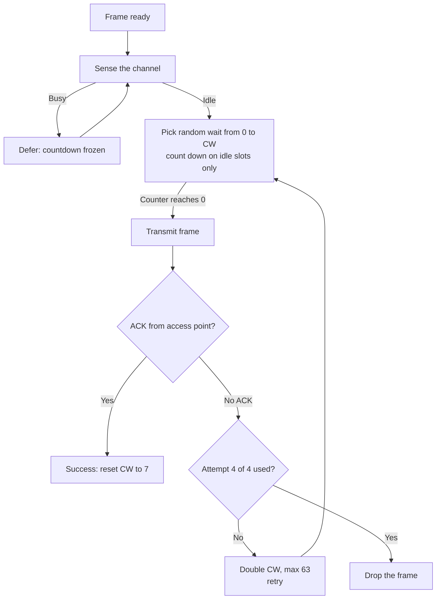
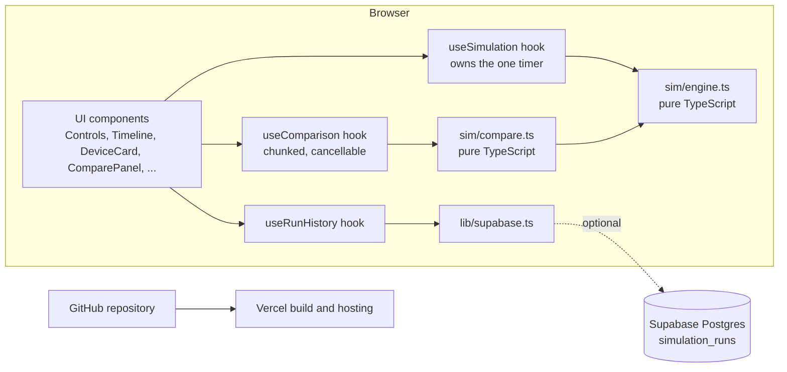

# Who gets to speak? — Classroom WLAN Simulator

**An interactive browser demo that shows how Wi-Fi devices take turns on one shared channel (CSMA/CA).**


> **No database or account needed.** The simulator runs entirely in your browser. Saving run history to Supabase is an optional extra; without it the app simply shows "Local only".

## Contents

1. [Introduction](#introduction)
2. [Why we built this](#why-we-built-this)
3. [Use cases](#use-cases)
4. [See it working](#see-it-working)
5. [How CSMA/CA works here](#how-csmaca-works-here)
6. [Run it on any laptop](#run-it-on-any-laptop)
7. [Architecture](#architecture)
8. [Optional: save run history with Supabase](#optional-save-run-history-with-supabase)
9. [Deploy on Vercel](#deploy-on-vercel)
10. [Git workflow](#git-workflow)
11. [Limitations](#limitations)
12. [Author and license](#author-and-license)

---

## Introduction

All the laptops and phones in a classroom share one Wi-Fi channel. Only one of them can send to the access point at a time. If two send at once, their signals overlap and neither message gets through.

Wi-Fi handles this with **CSMA/CA** — *carrier sense multiple access with collision avoidance*. Each device listens first and, if the channel is free, waits a random number of short time slots before it sends. If no acknowledgement (ACK) comes back, it assumes a collision, waits a longer random time and tries again.

## Why we built this

On real Wi-Fi, collisions and backoff happen in microseconds, so nobody can see them. Textbooks show static diagrams that make it hard to follow *who decided what, and when*.

This simulator slows everything down to one slot at a time. You can watch every device listen, count down, send, collide and retry. A seeded random generator makes any scenario **repeatable**, so a lecturer can show exactly the same collision to every class.

## Use cases

- **Lecture demo** — step through one round on the projector and explain each slot.
- **Lab exercise** — students change devices and load, then record collisions and utilisation.
- **Self-study and revision** — replay a seed until the backoff rules make sense.
- **Explaining hidden nodes** — switch on the hidden-node toggle, pick which students cannot hear each other, and watch them collide.
- **Comparing light vs heavy load** — run the same device count on light and heavy traffic and compare the summary counters.
- **Comparing many scenarios at once** — tick several device counts (2–20), loads and hidden-node settings, and get a side-by-side results table averaged over several seeds.
- **"What if" experiments** — change the wait windows, retry limit, frame length or round length and see how the results move.

## See it working

| Screen | Image |
| --- | --- |
| Overview |  |
| A collision |  |
| Hidden-node problem |  |
| Compare scenarios |  |
| Mobile layout |  |

### Try this

1. **See a collision.** Set **10 devices**, **Heavy** load, keep **Repeatable scenario** on and type seed **5**, then press **Run one round**. Round 1 has three collisions. Watch the *Collision* slots and the doubling wait windows (0–7 → 0–15).
2. **See the hidden-node problem.** Set **6 devices**, **Medium** load, switch on **Hidden-node problem** and use seed **105** (the default). Press **Run one round**: Student 1 starts sending in slot 2, Student 2 (who cannot hear it) joins in slot 3, and both frames are lost.
3. **See a dropped frame.** Set **20 devices** and **Heavy** load, keep seed **105**, and press **Run simulation**. By round 5 the *Dropped frames* counter goes up. Read the event log to see the fourth failed attempt.
4. **Compare scenarios.** Scroll to **Compare scenarios**. Keep device counts 5, 10, 15 and 20, tick all three preset loads, and press **Run comparison**. Collisions rise and utilisation falls as the room fills up.
5. **Change the rules.** Open **Model settings**, set the largest wait window to **0–15**, and run the same comparison again. With 20 devices the window can no longer grow enough, so collisions and drops climb.

## How CSMA/CA works here



The flowchart shows the default values. Every number in it can be changed under **Model settings**.

Key rules in this teaching model:

- **2 to 20 devices** (Student 1 … Student 20) share one access point.
- The wait (backoff) is picked from **0 to CW**. CW starts at **7** and doubles after each failure, up to **63**. These are simplified values.
- Countdowns only tick on **idle** slots. They **freeze** while someone else is sending.
- A frame lasts **2 slots** and is followed by **1 ACK slot** from the access point.
- Wi-Fi radios generally **cannot detect a collision while sending**. They only infer it because no ACK arrives.
- A frame gets **4 attempts** in total. After the fourth failure it is dropped.
- Traffic load is the chance each idle device has a new frame each round: light ≈ 30%, medium ≈ 60%, heavy ≈ 90%, or a **custom** 0–100%.
- **Hidden-node mode:** the chosen students (Students 1 and 2 by default, at least two) cannot hear each other, so their countdowns do not freeze for each other. They are uploading coursework, so they always have a frame ready. A collision only counts as a *hidden-node collision* when a student starts sending over someone it could not hear. Two students who simply reach zero in the same slot cause an ordinary collision.
- One round is a 12-slot window. Unfinished frames carry over into the next round.

### Model settings you can change

| Setting | Default | Range |
| --- | --- | --- |
| Starting wait window | 0–7 | 0–1, 0–3, 0–7, 0–15, 0–31, 0–63 |
| Largest wait window | 0–63 | 0–7 up to 0–1023 (never below the starting window) |
| Attempts per frame | 4 | 1–10 |
| Frame length | 2 slots (+1 ACK slot) | 1–4 slots |
| Slots per round | 12 | 6–40 |

Windows are always 2ⁿ − 1, so doubling stays on the same ladder. **Restore defaults** puts every value back.

### Compare scenarios

The **Compare scenarios** panel runs many settings without animation and shows them in one table:

- Tick any device counts (2–20), loads (light, medium, heavy, custom) and hidden-node off/on.
- Choose **rounds per run** (1–200) and **seeds to average** (1–10). Every scenario uses the same seeds, starting from the seed shown in the Scenario panel, so the comparison is fair and repeatable.
- The current model settings and hidden students are used. If a chosen hidden student does not exist at a smaller device count, Students 1 and 2 are used, and the table shows which ones.
- The table shows the averages for delivered frames, collisions, hidden-node collisions, retries and dropped frames. It also shows the delivery rate (delivered ÷ (delivered + dropped)) and utilisation, and marks the best utilisation and the most collisions.
- Very large comparisons (over 1,000,000 simulated slots) are blocked with a message. Running comparisons can be cancelled.

## Run it on any laptop

### Prerequisites

- **Node.js LTS** — version 22.12 or newer, or 24 (see `.nvmrc`). Node 25 is not supported by the test runner.
- **Git**

Check what you have:

```bash
node -v
git --version
```

### Windows (PowerShell)

```powershell
# 1. Install Node.js LTS and Git (skip if already installed)
winget install OpenJS.NodeJS.LTS
winget install Git.Git

# 2. Get the code (close and reopen PowerShell after installing)
git clone https://github.com/Aditya-7826/classroom-wlan-sim.git
cd classroom-wlan-sim

# 3. Install and run
npm install
npm run dev
```

### macOS

```bash
# 1. Install Node.js LTS and Git with Homebrew (skip if already installed)
brew install node@24 git

# 2. Get the code
git clone https://github.com/Aditya-7826/classroom-wlan-sim.git
cd classroom-wlan-sim

# 3. Install and run
npm install
npm run dev
```

### Linux (Debian / Ubuntu)

```bash
# 1. Install Git and Node.js LTS via nvm (skip if already installed)
sudo apt update && sudo apt install -y git curl
curl -o- https://raw.githubusercontent.com/nvm-sh/nvm/v0.40.3/install.sh | bash
source ~/.bashrc
nvm install 24

# 2. Get the code
git clone https://github.com/Aditya-7826/classroom-wlan-sim.git
cd classroom-wlan-sim

# 3. Install and run
npm install
npm run dev
```

Then open **http://localhost:5173** in your browser.

### Other commands

```bash
npm run build     # type-check and build into dist/
npm run preview   # serve the built app locally
npm test          # run the simulation-engine tests
```

### Troubleshooting

| Problem | Fix |
| --- | --- |
| `Port 5173 is in use` | Close the other dev server, or run `npm run dev -- --port 5174` and open that port. |
| `Unsupported engine` or odd install errors | Your Node version is too old (or is v25). Install Node 24 LTS, or run `nvm use` in the project folder. |
| Blank page | Open the browser console (F12). Make sure you opened the URL that `npm run dev` printed, and run `npm install` again after pulling changes. |
| Pill says "Local only" | That is normal without Supabase. See the optional section below. |
| "Local only" even with Supabase set up | Check that you ran **both** migration files, in order, then restart `npm run dev`. |
| Comparison button is greyed out | Tick at least one option in each group, or lower the rounds or seeds (the message under the button says which). |

## Architecture



### Folder tree

```text
classroom-wlan-sim/
├── docs/screenshots/          # images used in this README
├── public/favicon.svg
├── src/
│   ├── components/            # Header, Controls, ChannelTimeline, DeviceCard, SummaryStats,
│   │                          # EventLog, LearnPanel, ComparePanel, DbStatus, RunHistory
│   ├── hooks/
│   │   ├── useSimulation.ts   # state + the single interval timer
│   │   ├── useComparison.ts   # runs comparisons in small, cancellable chunks
│   │   └── useRunHistory.ts   # optional saving / loading of run summaries
│   ├── lib/supabase.ts        # client, or null when not configured
│   ├── sim/
│   │   ├── random.ts          # seeded PRNG (mulberry32)
│   │   ├── types.ts
│   │   ├── engine.ts          # input checks, step(state), runRound(state), runRounds(state, n)
│   │   ├── compare.ts         # builds and runs scenario comparisons
│   │   ├── engine.test.ts     # Vitest tests, incl. 300 random scenarios checked for consistency
│   │   └── compare.test.ts
│   ├── styles/
│   │   ├── tokens.css         # all colours and sizes
│   │   └── app.css
│   ├── App.tsx
│   └── main.tsx
├── supabase/migrations/       # SQL for the optional run-history table
├── .env.example
└── index.html
```

### Why the engine is separate from React

The simulation lives in `src/sim/` and does not import React. `step(state)` takes a state and returns a new one, and all randomness comes from a seeded generator stored inside that state. That means:

- the rules can be **unit-tested** without a browser;
- the same seed and settings always give the **same run**;
- the UI only *displays* state, so it cannot accidentally change the rules;
- the engine **checks every input itself**: out-of-range numbers are clamped, wait windows snap to valid values, and unknown options fall back to defaults, so no setting can put it in an impossible state.

## Optional: save run history with Supabase

**You can skip this section.** The app works fully without a database. If you connect one, it saves an anonymous summary each time a round finishes, or when you pause or reset a running simulation. The summary includes the model settings, and the app shows the last 10 runs. Comparison results are not saved.

1. Create a free project at [supabase.com](https://supabase.com).
2. Open **SQL Editor** and run the two migration files **in this order**, pasting each one and pressing *Run*:
   1. `supabase/migrations/20261106224500_create_simulation_runs.sql` — creates the table.
   2. `supabase/migrations/20261110190000_extend_simulation_runs.sql` — allows up to 20 devices and adds the model-setting columns. It is safe to run on a table that already has rows.
3. In **Project Settings → API**, copy the **Project URL** and the **publishable key**.
4. Copy the example env file and fill in both values:

   ```bash
   cp .env.example .env.local
   ```

   ```ini
   VITE_SUPABASE_URL=https://your-project.supabase.co
   VITE_SUPABASE_PUBLISHABLE_KEY=your-publishable-key
   ```

5. Stop and restart `npm run dev`. The pill should now say **Run history: connected**.

### Why the publishable key is safe here

The publishable key is meant to be visible in the browser. It is only safe because **Row Level Security (RLS)** is turned on for the table. The policies allow anonymous users to **insert** rows that pass the range checks and to **read** rows. There are no update or delete policies, so nobody can change or remove saved runs.

The table also has its own **check constraints**, so a row is rejected unless it makes sense. For example, the load must match the traffic level, the largest window cannot be smaller than the starting one, and the hidden count must fit the device count. The app clamps every value before saving, so a very long run never fails these checks.

Things to know:

- RLS cannot limit *how many* rows someone reads. The app asks for `order by created_at desc limit 10`. The table holds no personal data, so public reads are fine.
- Anyone with the key can insert rows, so the table could be spammed. That is acceptable for a class demo.
- **Never** put a secret or service-role key in this project or in `.env.local`.

If Supabase is unreachable, the app switches to **Local only** and keeps working.

## Deploy on Vercel

1. Push the repository to GitHub (see [Git workflow](#git-workflow)).
2. On [vercel.com](https://vercel.com), choose **Add New → Project** and import the repository.
3. Framework preset: **Vite** (detected automatically). Build command `npm run build`, output folder `dist`.
4. Optional: under **Environment Variables**, add `VITE_SUPABASE_URL` and `VITE_SUPABASE_PUBLISHABLE_KEY`.
5. Click **Deploy**.

Vite bakes environment variables in at build time, so **redeploy after changing them**.

## Git workflow

```bash
git add .
git commit -m "Describe your change"
git push
```

Check that every commit lists only you as the author, with no extra trailers:

```bash
git log --format="%an <%ae>%n%b" | grep -iE "claude|anthropic|co-authored"
```

This should print nothing.

## Limitations

This is a **simplified teaching model**, not an IEEE 802.11-accurate simulation.

- No real timing: no SIFS, DIFS or slot durations, and no PHY or radio physics.
- No RTS/CTS, so the hidden-node problem is never solved here — on purpose.
- The default contention windows (7 to 63), 2-slot frames and 4-attempt limit are simplified. The adjustable ranges are for experiments and are not real 802.11 values either.
- Every device can always reach the access point. There is no signal strength, rate adaptation or interference from other networks.
- Rounds are fixed windows (12 slots by default, 6–40 adjustable) to keep the display readable.
- Hidden students always have a frame ready, so the hidden-node problem shows up quickly.
- The guaranteed round-1 hidden-node collision for seed 105 holds only with the default model settings and the default hidden pair (Students 1 and 2). Other settings may need a few rounds or a different seed.
- Comparisons run in the browser in small chunks. They are capped at about 1,000,000 simulated slots, so a run takes a few seconds at most.
- Anonymous inserts to the optional run history can be spammed. That is acceptable for a class demo, and the table holds no personal data.

## Author and license

**Author:** Karthikeyan Pandita

**License:** TODO: choose a license
